# EC2 Nginx Deployment with Terraform

## 1. Project Overview

This project demonstrates Infrastructure as Code (IaC) using Terraform to deploy an Ubuntu 20.04 LTS EC2 instance on AWS with the Nginx web server.

The configuration automatically installs Nginx and replaces the default webpage with a custom HTML page:

"Welcome to the Terraform-managed Nginx Server on Ubuntu"

## 2. Technologies Used

- Amazon Web Services (AWS)
- Terraform
- Amazon EC2
- Ubuntu 20.04 LTS
- Nginx
- Bash and HTML

## 3. Project Structure

```text
terraform-nginx-ubuntu/
├── main.tf
├── variables.tf
├── outputs.tf
├── .gitignore
└── README.md
```

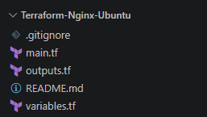

## 4. AWS Resources

Terraform manages the following resources:

- **EC2 Instance:** A t2.micro instance running Ubuntu 20.04 LTS.
- **Security Group:** Allows HTTP traffic on port 80 and SSH traffic on port 22.
- **User Data:** Installs Nginx and configures the custom HTML webpage.
- **Terraform Outputs:** Displays the public IPv4 address and website URL.

The configuration uses the existing default VPC and its subnet. It does not create a separate VPC, subnet, or internet gateway.

## 5. Prerequisites

- An AWS account with permissions to manage EC2 and security groups.
- Terraform CLI installed.
- AWS CLI installed and configured.
- Visual Studio Code or another text editor.

Configure AWS credentials using:

```powershell
aws configure
```

Verify access using:

```powershell
aws sts get-caller-identity
```

## 6. Configuration

Follow the project structure and create the .tf files :

---

main.tf ( Refer to the file included for the full code )

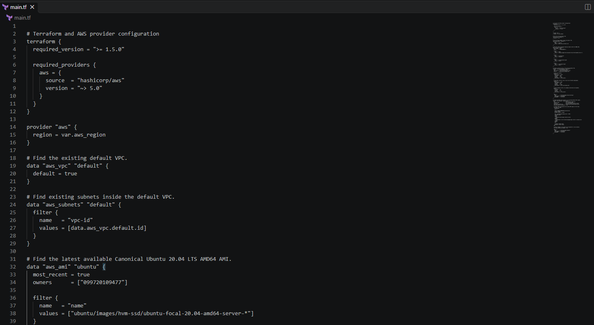


Note: this version of the deployment uses the existing VPC and Security Groups and Internet Gateway , however a version where all resources are seperately configured is also given in alternatemain.tf , refer to this file for the alternate version.

---

outputs.tf ( Refer to the file included for the full code )

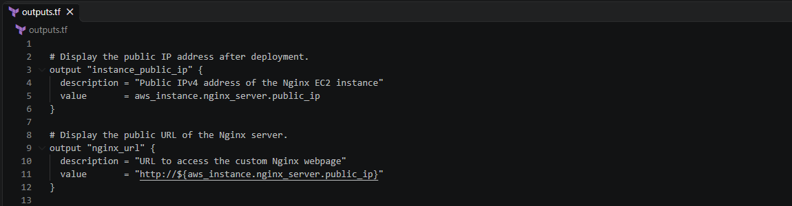

---

outputs.tf ( Refer to the file included for the full code )

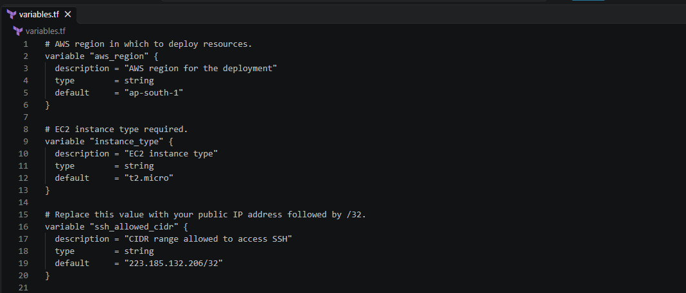

For SSH, replace the example CIDR with your own public IP followed by `/32`.

---

## 7. Deployment Instructions

Open a terminal in the project directory.

### Initialize Terraform

```powershell
terraform init
```

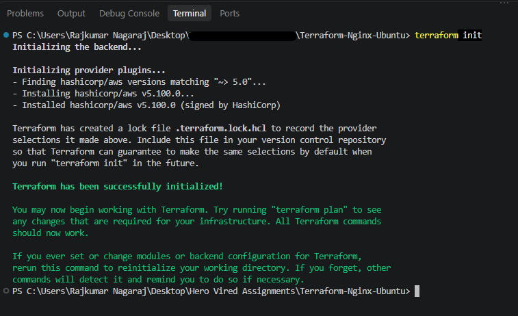

### Validate the configuration

```powershell
terraform validate
```

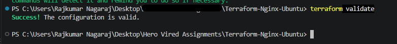

### Review the execution plan

```powershell
terraform plan
```

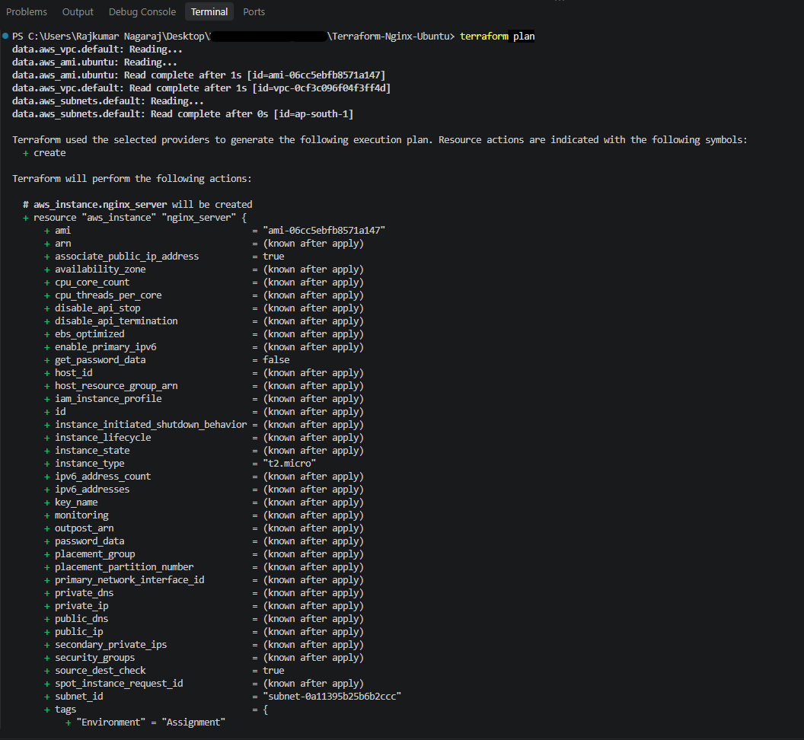
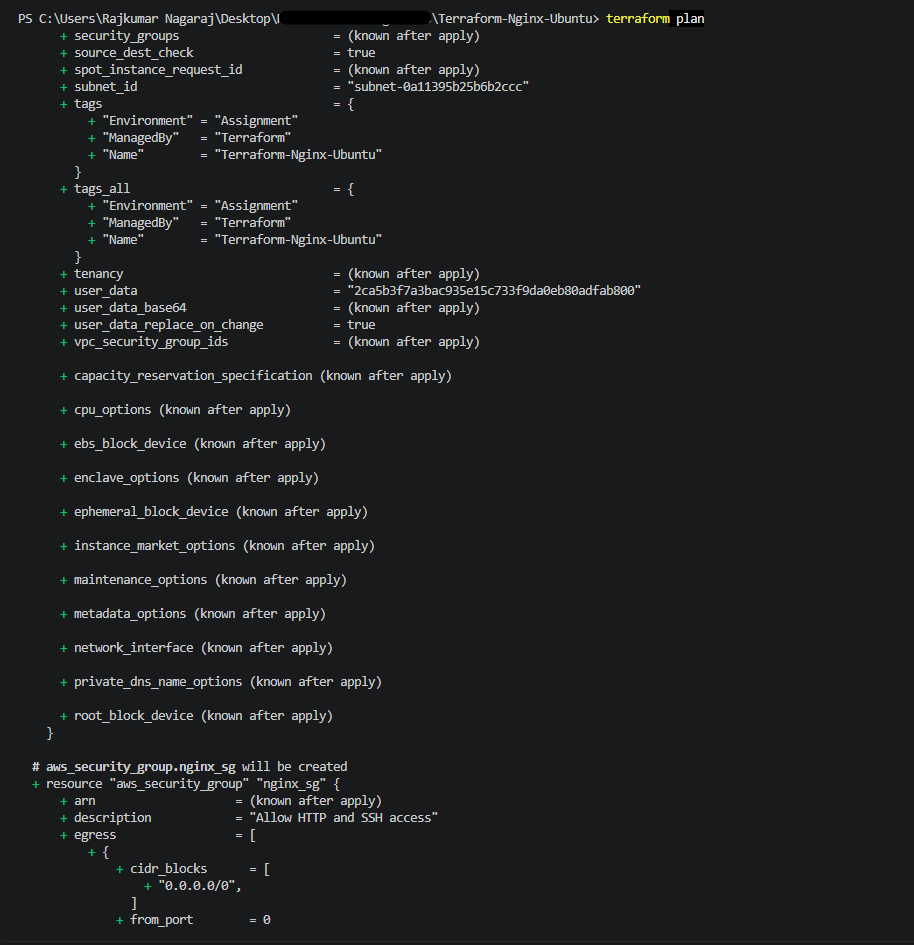
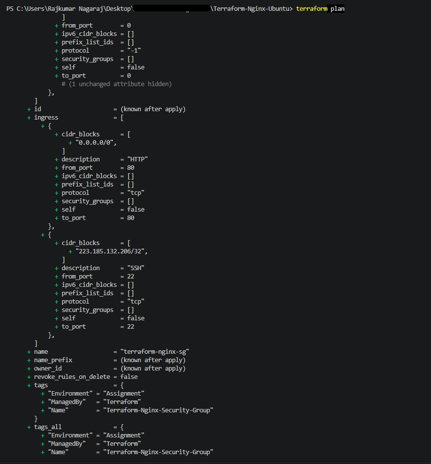
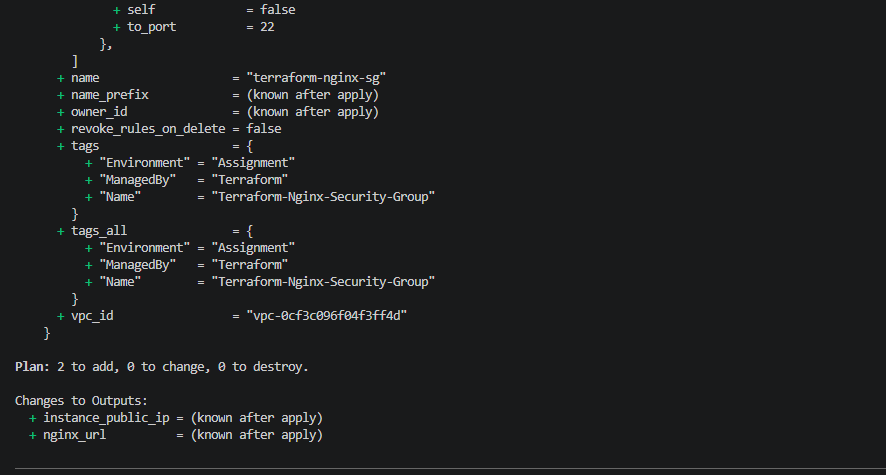

### Deploy the infrastructure

```powershell
terraform apply
```

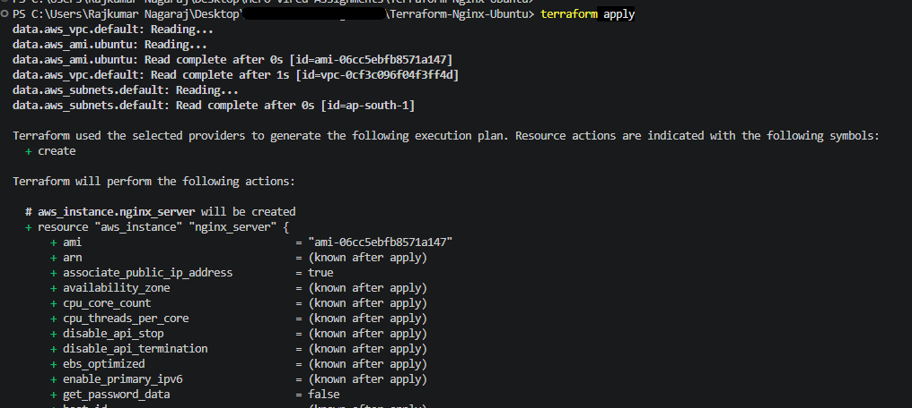

Enter `yes` when prompted.

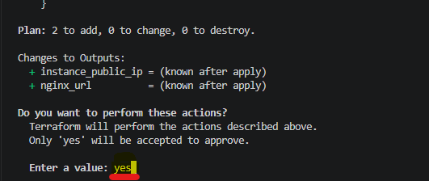

Terraform creates the EC2 instance and security group and displays the public IP and website URL.

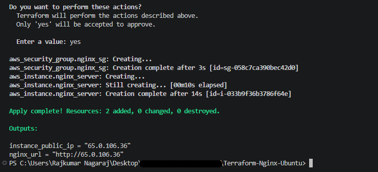

---

## 8. Access the Nginx Webpage

Copy the `nginx_url` value from the Terraform output and open it in a web browser.

Expected webpage content:

**Welcome to the Terraform-managed Nginx Server on Ubuntu**

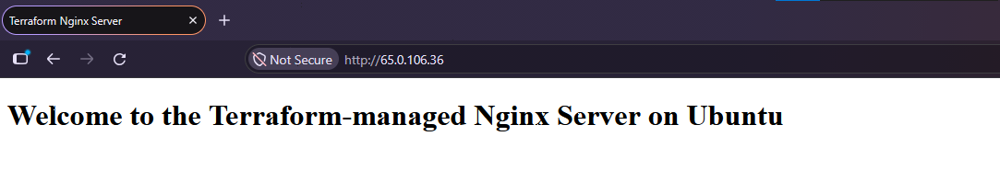

---

## 9. Visual representation of the AWS resources created by Terraform on the AWS Console

**EC2 Instance**

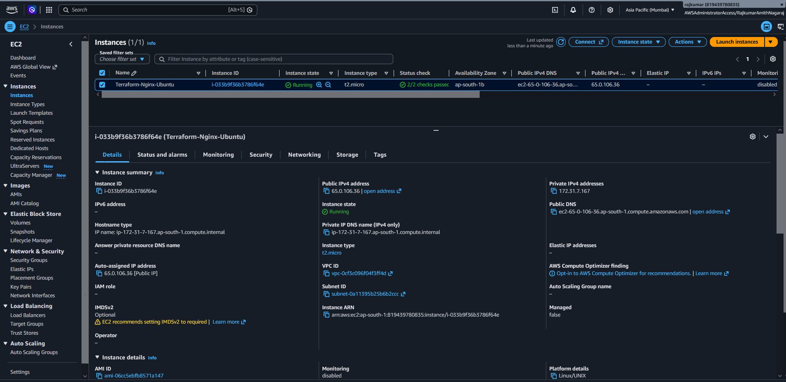

**EC2 Security Tab**

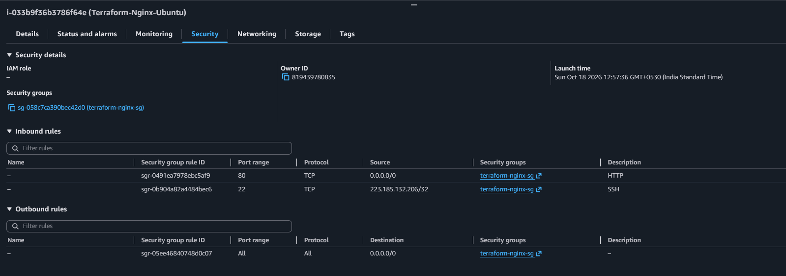

**EC2 Tags Tab**

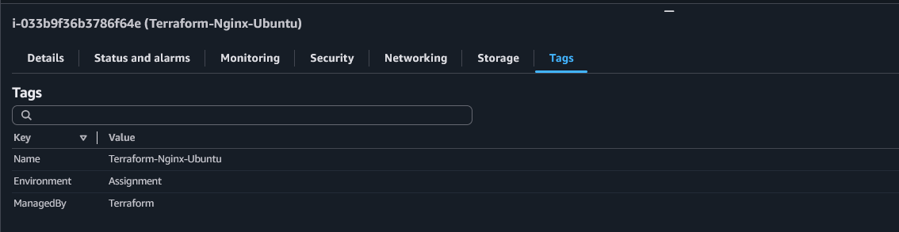

**Security Group Overview with Inbound & Outboud Rules**

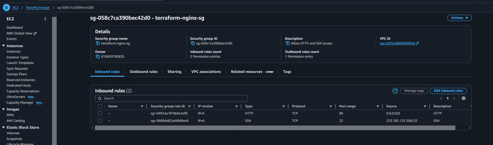

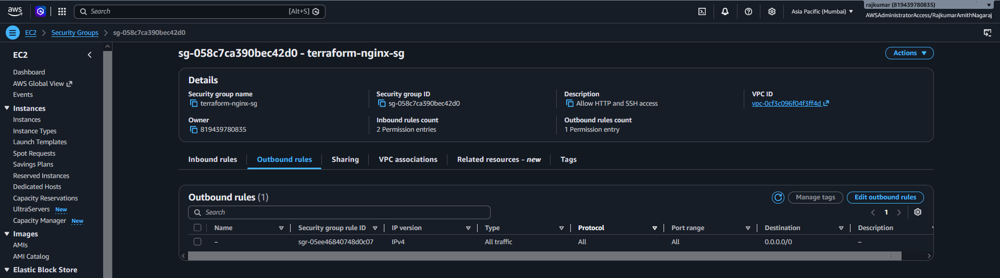

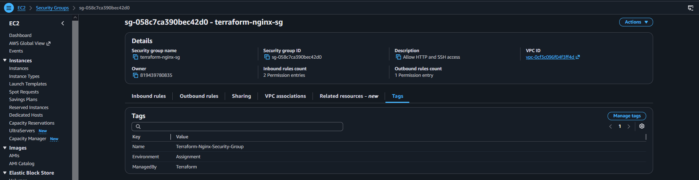

---

## 10. Cleanup

To remove the resources created by this project, run:

```powershell
terraform destroy
```

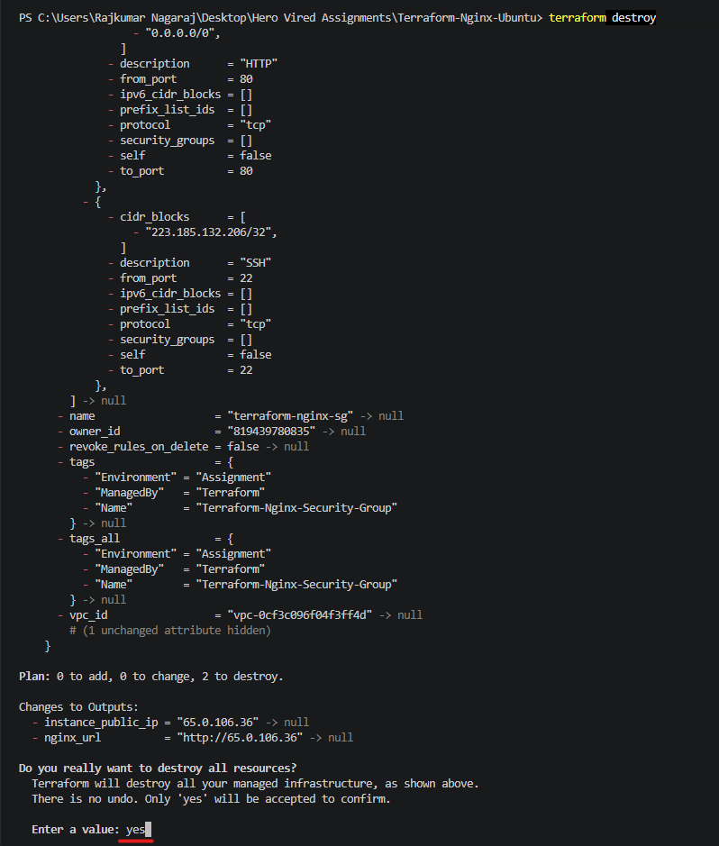

Enter `yes` when prompted.

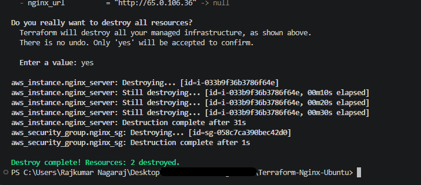

Verify that Terraform reports that the resources were destroyed.

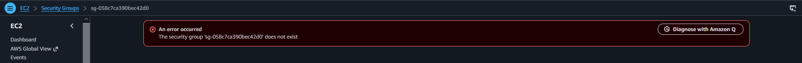

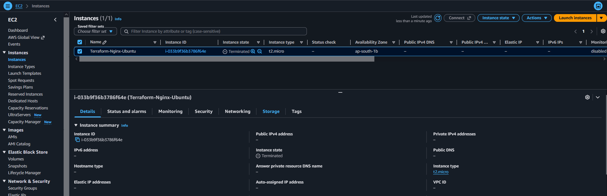

---

## 11.Final Project Folder Structure to Expect

In this deployment, we use gitignore to make sure that some of the terraform file containing critical credentials are not included in the git uploads.
This is followed as per best security practices.

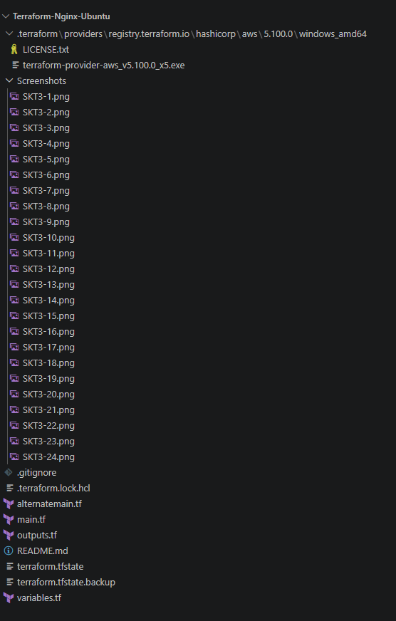

---

## 11. Conclusion

This project demonstrates how Terraform can automate AWS infrastructure provisioning using Infrastructure as Code principles. It provisions an Ubuntu EC2 instance, configures a security group, installs Nginx through user data, serves a custom webpage, outputs the public IP address, and removes the managed infrastructure through Terraform destroy.

---